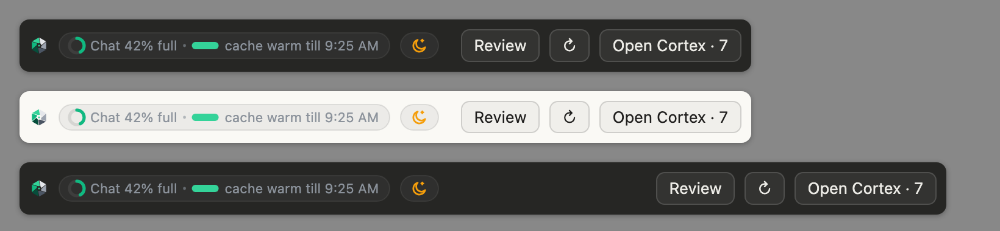
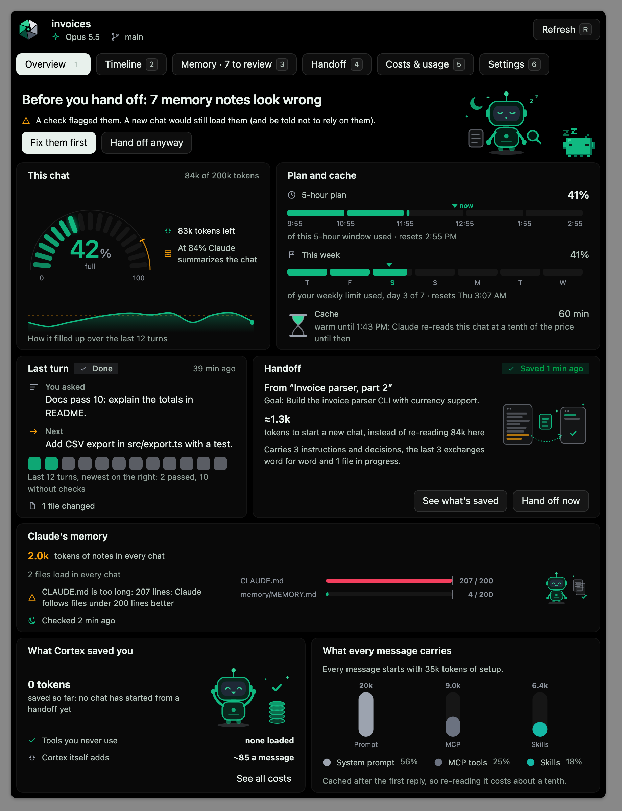
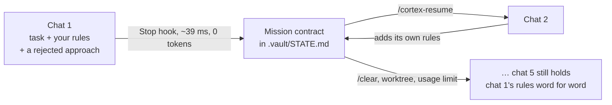
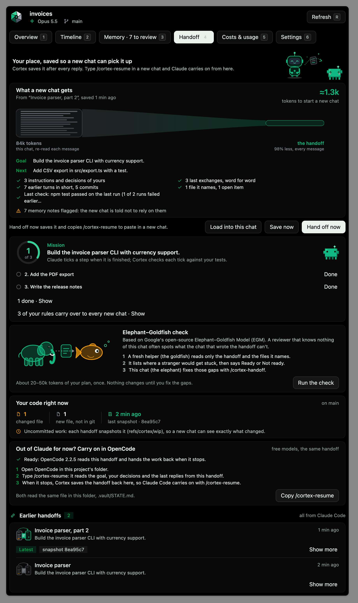
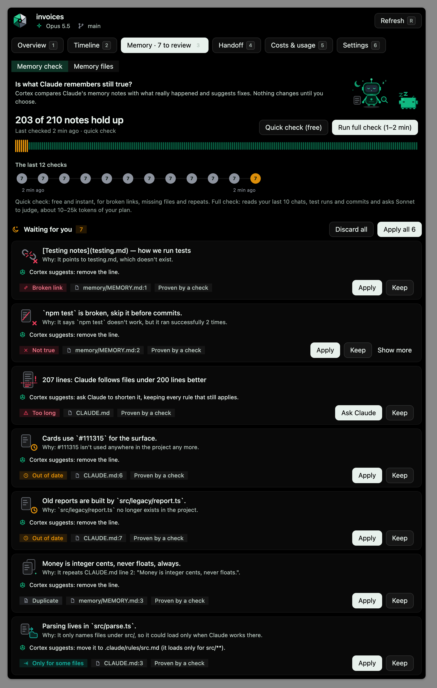
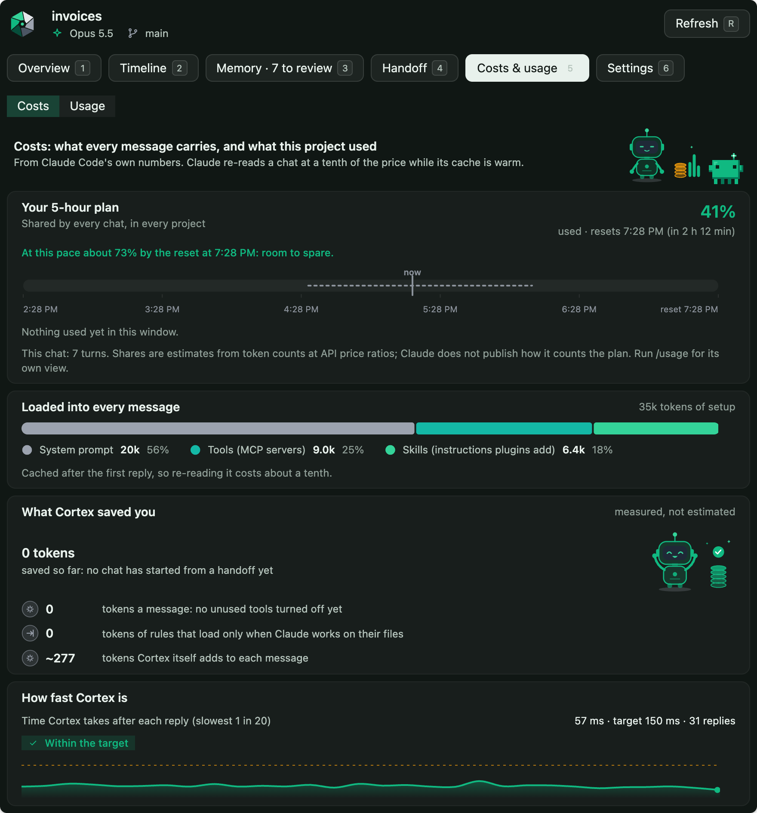
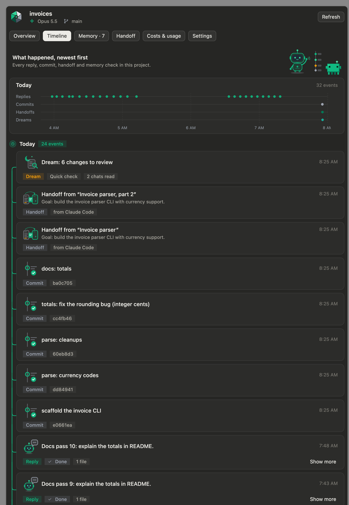

<div align="center">


# Kapex Cortex

**Switch Claude Code chats without losing context, see what every message costs, and keep Claude's memory true.**

[](CHANGELOG.md)
[](LICENSE)
[](package.json)
[](docs/ARCHITECTURE.md#3-zero-passive-injection)
[](#benchmarks)
[](https://github.com/kafilcodes/kapex-cortex/actions/workflows/ci.yml)

</div>

**Kapex Cortex is an open-source Claude Code plugin** (MIT, zero runtime dependencies) that adds what Claude Code and Claude Desktop don't have: a **lossless handoff** so a new chat continues exactly where the last one stopped, even five chats later; a **live status strip** with context %, a prompt-cache countdown and plan use; a **costs panel** that shows what every MCP server and skill adds to each message; and **Dreams** that check `CLAUDE.md` and Claude's memory against what really happened. It adds **0 tokens** to your normal chats.

<p align="center"></p>

<p align="center"></p>

## Install

You need [Node.js 23.6+](https://nodejs.org). In Claude Code (CLI or Desktop), paste:

```text
/plugin marketplace add kafilcodes/kapex-cortex
/plugin install kapex-cortex@kapex-cortex
```

In the install pane, pick **Install for you (user scope)** so Cortex works in every repository and over SSH. Then run `/reload-plugins` (or open a new chat), press **Open Cortex** above the prompt (or type `/kc`), and press **Turn on Cortex** once in each project.

From a terminal instead:

```bash
claude plugin marketplace add kafilcodes/kapex-cortex && claude plugin install kapex-cortex@kapex-cortex --scope user
```

### Install with your AI agent (one prompt)

Paste this into Claude Code, Codex or OpenCode:

```text
Install the Kapex Cortex plugin for Claude Code and verify it. Steps: 1) check `node --version` is 23.6 or newer (stop and tell me if not); 2) run `claude plugin marketplace add kafilcodes/kapex-cortex`; 3) run `claude plugin install kapex-cortex@kapex-cortex --scope user`; 4) run `claude plugin details kapex-cortex` and confirm it lists the skills cortex-resume, cortex-handoff, cortex-init and kc and five hooks; 5) tell me to run /reload-plugins (or open a new chat) and then /kc to open the panel and press Turn on Cortex. Don't change any other setting.
```

## What it does

| | What you get | Why it matters |
|---|---|---|
| **Lossless handoff** | After every reply, `.vault/STATE.md` holds a **mission contract** (the goal, your rules in your own words, the approaches you rejected) plus the turn trail and the last exchanges word for word. `/cortex-resume` continues in a new chat, after `/clear`, in a git worktree, or in OpenCode after a usage limit | A new chat starts from about 1–2k tokens with nothing lost, instead of a cold re-read or a lossy summary |
| **Status strip** | One line above the prompt, live between replies: context ring, prompt-cache countdown, 5-hour plan, and one tip ("82% full · hand off, save ~800k") | Claude Code shows no cache timer, and plan use hides behind `/usage` |
| **Costs & usage** | What each MCP server and skill adds to *every* message, one press to turn off unused ones, token burn by day, when you work, what Claude does | Unused tools can cost thousands of tokens per message, unseen |
| **Dream** | Checks `CLAUDE.md`, `.claude/rules/` and auto memory against your chats, test runs and git; proposes fixes you Apply or Undo | One wrong note ("`npm test` is broken") is trusted by every future chat |
| **Safety for long runs** | Checks for readable secrets, the sandbox and a test gate before auto mode; one press to fix, one to undo | Deny rules hold before auto mode's own check |

## How it works

Cortex is shell hooks that write files when a reply ends (no model, no tokens) plus a panel that draws beside the chat. Nothing is added to your prompts. [Full architecture with diagrams →](docs/ARCHITECTURE.md)



## Benchmarks

**Measured 2026-11-25** on an Apple M4 MacBook Air, Node 26, with `node scripts/benchmark.ts` (no model, no tokens, temp folders only; you can run it yourself):

| What | Result |
|---|---|
| **5-hop telephone**: five consecutive chats on one task with adversarial noise turns ("I don't see the button", "Work done in the last chat broke the build"); does chat 5 still hold chat 1's mandatory skill, never-rule, scope rule, rejected approach and goal? | **13/13 probes** (the v4.0.0 release's handoff kept 3 of the same 7 facts) |
| Handoff after 25 turns: does `STATE.md` answer 10 fixed questions (goal, a turn-3 decision, a turn-14 bug and its file, the next step…)? | **10/10**, about 1.1k tokens |
| Dream Quick check: 6 planted problems among 204 valid rules | **6/6 found, 0 false positives** |
| Apply, then Undo | every memory file back **byte for byte** |
| Stop hook, whole process | **p50 39 ms**, p95 56.7 ms (bar 60), 61 MB peak |
| Panel refresh (status read) | **p50 64 ms** (was 133 ms in v4.0) |
| Tokens Cortex adds to a normal chat | **0** (measured with `/context`) |
| Automated tests | **223** (84 core on macOS, Linux and Windows CI; 139 panel) |

## The panel

<table>
<tr>
<td width="50%"></td>
<td width="50%"></td>
</tr>
<tr>
<td><b>Handoff</b>: what a new chat gets, one-press hand off, a fresh-eyes check, your code right now, earlier handoffs by chat name.</td>
<td><b>Memory</b>: the Dream's findings, each with Cortex's suggestion beside Apply and Keep; what loads into every chat and what it costs.</td>
</tr>
<tr>
<td></td>
<td></td>
</tr>
<tr>
<td><b>Costs & usage</b>: the 5-hour plan on a pace track, what every message carries, tools you never use, token burn by day.</td>
<td><b>Timeline</b>: every reply, commit, handoff and Dream as a tile that opens for details.</td>
</tr>
</table>

Screenshots show the **Kapex Obsidian** theme (true black with an emerald cast, the default Kapex look in dark mode; Mist in light mode; Settings → Look turns it off). The panel follows Claude Code's light or dark mode and fits a half-width pane. A panel button never sends a prompt by itself.

## FAQ

### How do I switch chats in Claude Code without losing context?

Install Kapex Cortex, then type `/cortex-resume` in the new chat (or press **Resume** on the strip). The new chat reads `.vault/STATE.md`, which Cortex rewrote after your last reply: the goal, your rules word for word, the approaches you rejected, the trail of earlier turns, and the last exchanges in full. It works across `/clear`, new chats, git worktrees and usage limits, and holds up over five chats in a row (13/13 in the telephone benchmark).

### How do I see what MCP tools and skills cost per message in Claude Code?

Open the panel (`/kc`) → **Costs & usage**. It lists what each MCP server and plugin skill adds to every message, flags the ones you never used in recent chats, and turns them off for new chats with one press (Claude Code's own per-project switch, undoable).

### Does Kapex Cortex inject prompts or slow down Claude Code?

No. It adds **0 tokens** to normal chats: its skills run only when you type them, its one panel tool (`open_panel`) is a deferred tool that `/context` counts as 0, and the handoff reaches a chat only when you run `/cortex-resume`. It never rewrites or compresses prompts, so Claude Code's prompt cache works as designed. Its Stop hook takes about 39 ms (median) after a reply ends and always exits cleanly. One thing it does change on its own: **auto-park** (on by default) turns off MCP servers you haven't used in 10 chats here, through Claude Code's own per-project `disabledMcpServers` switch in `~/.claude.json`; one press brings a server back, and `kc prefs set autoPark off` stops it. See [SECURITY.md](SECURITY.md).

### How does it handle git worktrees, `/clear` and several chats at once?

One repository has one vault, so a chat in any worktree (including Claude Desktop's own `.claude/worktrees/*`) hands off through the same `STATE.md`, and the packet names the worktree to work in. After `/clear` or a resume, the strip starts over for the new chat at once. Several chats in one project never overwrite each other's handoff, and a quick "hi" in a side tab never replaces the real one.

### How do I know when the prompt cache is about to go cold?

The strip shows a countdown ("cache warm till 6:11 PM") that drains and changes colour as the cache cools. On a big chat it suggests replying or handing off before the cache goes cold, when the next message would re-read everything at full price.

### What does a Dream check, and can it break my CLAUDE.md?

A Dream checks the facts in `CLAUDE.md`, `.claude/rules/` and auto memory against evidence a program extracts from your chats, test runs and git: false or stale notes, duplicates, broken links, files over Claude's limits, notes that belong in a path-scoped rule. A rule the code has drifted from is shown as drift, never deleted. Nothing changes until you press Apply, and every Apply can be undone byte for byte.

### What happens when I hit the 5-hour limit?

Cortex stamps the handoff **ready** and keeps your last real answer (the "You've hit your limit" notice never replaces it). Continue in OpenCode with `/cortex-resume` (free models work), or after the reset in a new chat.

## Commands

| Command | Does |
|---|---|
| `/kc` | Open the panel |
| `/cortex-resume` · `/cortex-handoff` | Continue from the handoff · record one with decisions |
| `kc d` · `kc d run` · `kc d show` · `kc d apply <id>` · `kc d undo <id>` | Dream in the background · now · review · apply · undo |
| `kc park add <server>` · `kc park remove <server>` | Turn an MCP server off or on for new chats here |
| `kc safety` · `kc safety apply secrets\|gate` · `kc safety undo` | The safety check |
| `kc h` · `kc r` · `kc s` · `kc m` | Save a handoff · show it · status · memory files |
| `kc prefs set startNotice on` | Opt in to a one-line "a handoff exists" note in new chats (off by default) |

## Safety

| Guard | Means |
|---|---|
| Proposes, never writes | Nothing changes until you Apply; every Apply can be undone byte for byte |
| 0 tokens, no network | Nothing injected into chats; no network calls of its own (only a Dream judged with your own API key, if you set one) |
| Your files stay yours | `~/.claude` is only read; settings changes keep every other key |
| Secret scrubber | Keys, tokens and passwords are redacted before anything is saved |
| Never breaks your tool | Every hook exits 0; errors go to `.vault/private/errors.log` |
| Claude Code's own switches | It never patches Claude Code or bypasses a permission prompt |

See [SECURITY.md](SECURITY.md) to report a problem privately.

## Honest limits

- **Dream quality is measured on planted problems, not on months of real use.** Real memory files are messier.
- **The program checks are narrow by design.** Without a model, a Dream finds only what it can prove.
- **Rules are read by pattern, not by a model.** A rule phrased very unusually may not be pinned; the full message is still in the handoff's trail.
- **Transcripts:** the Claude Code CLI deletes them after 30 days by default (`cleanupPeriodDays`); since v2.1.248 Claude Desktop keeps its own unless you set `desktopSessionCleanupPeriodDays`. A Dream sees only what is left, and Cortex carries on when files are gone.
- **Tested by hand on macOS** with Claude Code Desktop and CLI. Linux and Windows pass the core tests in CI.
- **The 5-hour plan split is an estimate.** Claude doesn't publish how it counts the plan; `/usage` is Claude's own view.

## Other tools

Cortex is built for Claude Code. **OpenCode** is supported as a fallback after a Claude usage limit: `/cortex-resume` works there, and an OpenCode plugin writes the handoff back. The handoff is plain Markdown, so any agent can read `.vault/STATE.md`.

## Contributing

Zero runtime dependencies, hooks that never break the harness, a 60 ms Stop-hook budget and 0 tokens in normal chats: see [CONTRIBUTING.md](CONTRIBUTING.md). Changes are listed in [CHANGELOG.md](CHANGELOG.md); [BUILD-LOG.md](BUILD-LOG.md) records what broke and how it was fixed; [llms.txt](llms.txt) is a short summary for AI assistants.

MIT © Mohd. Kafil Khan · [Kapex AI](https://kapex.ai)
