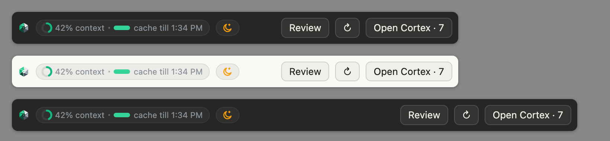
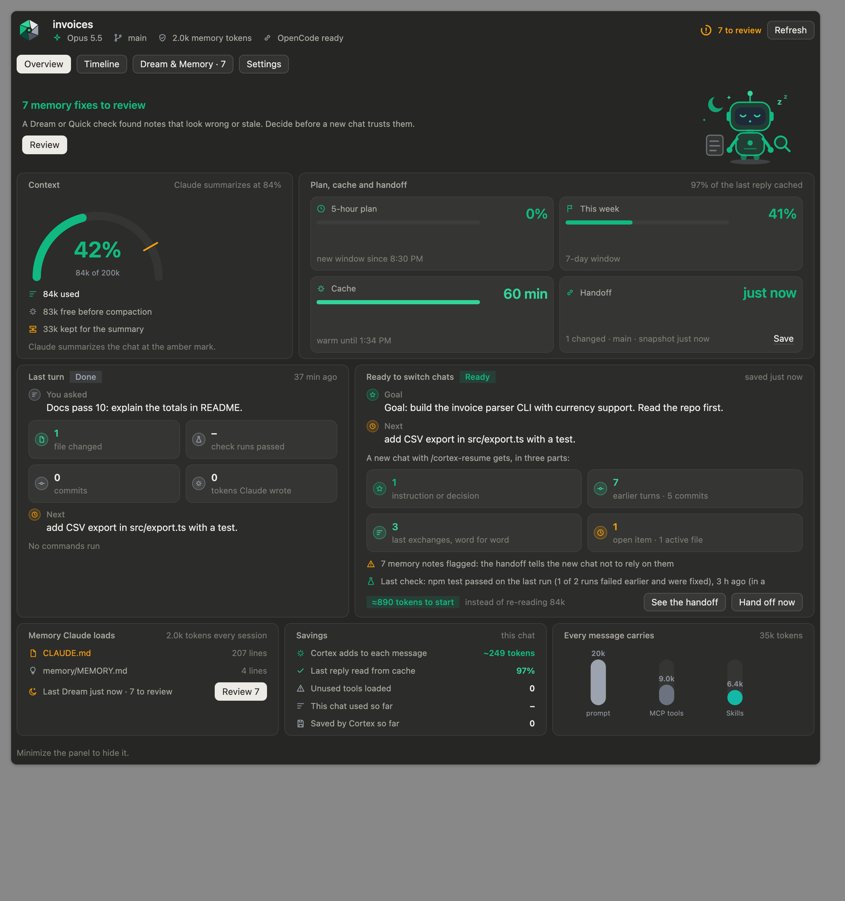
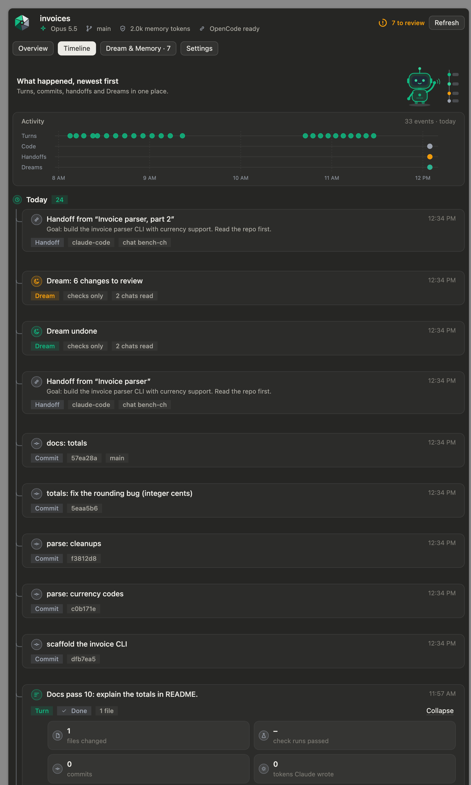

<div align="center">


# Kapex Cortex

**See what every Claude Code message costs, switch chats without losing your place, and keep Claude's memory true.**


</div>

<p align="center"></p>

<p align="center"></p>

## Install (10 seconds)

You need [Node.js 23.6+](https://nodejs.org). In Claude Code (CLI or Desktop):

```
/plugin marketplace add kafilcodes/kapex-cortex
/plugin install kapex-cortex@kapex-cortex
```

Open a new chat, press **Open Cortex** above the prompt (or type `/kc`), and press **Turn on Cortex** once. A three-step intro shows what's where.

## What is Kapex Cortex?

Kapex Cortex is an open-source **Claude Code plugin** (MIT, zero runtime dependencies) that adds four things Claude Code doesn't have, and works *with* Claude Code's own memory instead of keeping a store of its own:

| | What it adds | Why it matters |
|---|---|---|
| **Status strip** | One line above the prompt, live between replies (it notices the cache going cold or a plan window resetting without a new message): context ring, cache countdown, 5-hour plan, and a traffic-light tip: green "All good", amber "fine to continue" (cache cooling, filling up, a Dream due), red with the move and what it saves ("82% full · hand off, save ~800k"), one press to act | Claude Code shows no cache timer, and plan use is behind `/usage` |
| **Costs panel** | What each MCP server and skill adds to *every* message, with one press to turn off the unused ones; tokens this project used today, this week, all time | Unused tools can cost thousands of tokens per message, unseen |
| **Lossless handoff** | After every reply, `.vault/STATE.md`: the session's goal and your standing instructions, the trail of earlier turns, and the last exchanges word for word. `/cortex-resume` continues in a new chat (or in OpenCode after a usage limit) | A new chat starts from about 2k–7k tokens and keeps the plan, instead of a cold re-read or a lossy summary |
| **Dream** | Checks `CLAUDE.md`, `.claude/rules/` and auto memory against what really happened (your chats, test runs, git), and proposes fixes you Apply and Undo | One wrong note ("`npm test` is broken") is trusted by every future chat |
| **Safety for long runs** | Checks for readable secrets, the sandbox, and a test gate that sends Claude back when checks fail; one press to fix, one to undo | Deny rules hold before auto mode's own safety check, and a real gate stops Claude finishing on red tests |

## Common questions

### Does Cortex change Claude Code's prompts, cache or context?

No. Cortex never rewrites, compresses or injects into your messages, so Claude Code's prompt cache and compaction work exactly as designed. Its hooks write files; its panel and strip draw beside the chat. What it adds to Claude's context:

- **~250 tokens in every session**: the names and descriptions of its three skills (`claude plugin details kapex-cortex` reports this; the panel shows the live number).
- **One short note** when a chat opens with a handoff waiting.
- Whatever you choose to run: a skill (`/cortex-resume`), a fresh-eyes check, a Dream on your plan.

### How is it different from what Claude Code already does?

| Need | Claude Code built in | Cortex adds |
|---|---|---|
| Context use | `/context` (on demand) | A live ring above the prompt, a trend, turns left before compaction |
| Plan limits | `/usage` | 5-hour and weekly bars always in view, with reset times |
| Prompt cache | Works silently | A countdown of how long the cache stays warm, and a tip before it cools on a big chat |
| Memory | `CLAUDE.md`, rules, auto memory; `/doctor prompt-audit` reviews wording for the model | A Dream checks the *facts* in that memory against test runs, commits and your words |
| Switching chats | `/compact`, `/resume` (same chat) | A new chat that starts with the goal, your instructions and the last exchanges word for word |
| Parallel work | Subagents, agent view, agent teams, Projects | Nothing competing: Cortex stays the per-chat layer, in every session |

### Is it safe to install?

Nothing changes until you press Apply, and every Apply can be undone. Hooks always exit cleanly (Stop hook p95 about 50 ms on an M4), errors go to `.vault/private/errors.log`, secrets are scrubbed before anything is saved, and `~/.claude` files are only read. See [Safety](#safety).

## The panel

**Overview:** the context gauge; plan, cache and handoff as four cells; the last turn; what a new chat would get; the memory Claude loads; savings; what every message carries.
**Timeline:** turns, commits, handoffs and Dreams on a swimlane, then each as a tile that opens for details.
**Dream & Memory:** Dream findings with their evidence and buttons; the memory files Claude loads and their cost; the handoff, with a **fresh-eyes check**; Costs.
**Settings:** the Dream model and schedule, when to offer a fresh chat, handoff size, **Safety for long runs**, greeting.

It follows Claude Code's light or dark mode and fits a half-width pane.

## Lossless handoff

After every reply Cortex rewrites `.vault/STATE.md` from what it already stored (no model, 0 tokens), in three parts, each with its own share of the budget so a run of small final turns can't push the session's purpose out:

1. **Pinned for this session:** the request it started with, your standing instructions in your own words, the decisions `/cortex-handoff` recorded, and memory notes a check flagged but nobody fixed. A chat that starts with `/cortex-resume` **carries the chat it continues**: its goal, instructions, decisions and milestones (turns that committed or fixed a failing check, with their files), so chat 3 still knows what chat 1 decided.
2. **Session trail:** one line per earlier turn and the session's commits.
3. **Where we left off:** the last three exchanges word for word, the files edited, the last check, open items, and a git snapshot at handoff moments.

At 80% full (70% with a cold cache) Overview offers a fresh chat. At a usage limit the handoff is stamped ready: type `/cortex-resume` in OpenCode (free models work), and the handoff comes back when that session goes idle.

**Fresh-eyes check.** One press sends a helper that knows nothing of your chat to read only the handoff and the files it names, and say where it would get stuck. It's the "Goldfish" from Google's [Elephant-Goldfish model](https://github.com/google/elephant-goldfish-model); for design docs and spec drift, use that plugin.

<p align="center"></p>

## Dream: memory that stays true

1. **Reads** `CLAUDE.md`, `.claude/rules/*.md` and Claude's auto memory (your `~/.claude` files too, read-only).
2. **Extracts evidence by program**, not by model, from your last 10 chats and git: each test run and whether it passed, your own words, when each note was written, recent commits.
3. **Checks what a program can prove:** files over Claude Code's limits, broken links, files and colours that no longer exist, claims a real run contradicts, duplicates.
4. **Optionally asks a model** (Sonnet on your plan by default, OpenCode, your own API key, or none) for what needs judgment: stale notes, contradictions, notes that only matter for some folders (moved into path-scoped rules).
5. **Checks every model claim:** it must cite real evidence, can't carry commands, links or secrets, and must be at least 70% sure.
6. **Proposes, never writes.** Apply, Keep or Undo per finding; before and after copies in `.vault/dreams/`.

A **Quick check** runs the program-only checks in the background when files change: no model, no tokens.

## Benchmarks

`node scripts/benchmark.ts` lives a dummy project through **25 turns in two chats** (the second starts with `/cortex-resume`) with the real hooks, then measures. No model, no tokens, nothing outside temp folders. Three rounds of 50 runs on an M4 MacBook Air, Node 26:

| What | Result |
|---|---|
| Dream Quick check on 6 planted problems (a false note, a stale colour, a stale path, a duplicate, a broken link, a 207-line CLAUDE.md) among 204 valid rules | **6/6 found, 0 false positives** (precision and recall 100%), plus 1 suggestion (a rule that could be path-scoped) |
| Apply, then Undo | every memory file back **byte for byte** |
| Handoff after 25 turns: does `STATE.md` hold the answers to 10 fixed questions (goal, a turn-3 decision, a turn-14 bug and its file, the next step…)? | **10/10**, about 900 tokens |
| The same 10 questions to a zero-memory agent that reads only `STATE.md` ([the Goldfish test](bench/goldfish.md)) | **10/10** |
| Stop hook, whole process | p50 46 ms · p95 51–53 ms (limit 150) · 60 MB peak |
| SessionStart hook | p50 28 ms · p95 30–32 ms |
| Quick check: deciding it isn't needed · running it | 0.1 ms · p95 94–99 ms |

On a real repo (this one, a 12 MB transcript) the Stop hook measures p50 52 ms, p95 67 ms. Inside Claude Desktop the hook's own log shows slower outliers (up to ~150 ms) when the machine is busy as a reply ends; the Costs page shows yours.

Three independent AI design reviewers (Opus, Sonnet and Fable, shown only screenshots) scored the panel about 5–6 out of 10 for ease and craft, and 4 for plain language, before this release's wording pass. That is the bar we're working on, not a claim of polish.

## Safety for long runs

Settings → **Safety for long runs** checks three things Claude Code's docs recommend for auto mode and long sessions:

| Check | Fix (one press, undoable) |
|---|---|
| Can Claude's file tools read `.env` or `~/.ssh`? | Adds `Read` deny rules to `.claude/settings.json`. Deny rules run before auto mode's classifier |
| Is the sandbox on? | Explains only: `/sandbox` turns it on. It also limits network, so Cortex never flips it for you |
| Does anything check the work before Claude finishes? | Adds a Stop hook that runs your check (the handoff's Verify line, or `npm run check` / `npm test`) when Claude stops after changing files, and sends Claude back if it fails, at most 3 times. A plain `npm test` hook can't: a failure exits 1, which Claude Code treats as done |

## Commands

| Command | Does |
|---|---|
| `/kc` | Open the panel |
| `/cortex-resume` · `/cortex-handoff` | Continue from the handoff · record one with decisions |
| `kc d` · `kc d run` · `kc d show` · `kc d apply <id>` · `kc d undo <id>` | Dream in the background · now · review · apply · undo |
| `kc park add <server>` · `kc park remove <server>` | Turn an MCP server off or on for new chats here |
| `kc safety` · `kc safety apply secrets\|gate` · `kc safety undo` | The safety check |
| `kc h` · `kc r` · `kc s` · `kc m` | Save a handoff · show it · status · memory files |

## Safety

| Guard | Means |
|---|---|
| Proposes, never writes | Nothing changes until you Apply; every Apply can be undone byte for byte |
| Evidence by program | A Dream's proof comes from transcripts and git, not from a model's wording |
| Your files stay yours | `~/.claude` is only read; settings changes keep every other key |
| Secret scrubber | Keys, tokens and passwords are redacted before anything is saved |
| Never breaks your tool | Every hook exits cleanly; errors are logged, not shown |
| Claude Code's own switches | Turning off a server writes the same per-project list `/mcp` writes; the current chat's cache stays intact |

## Honest limits

- **Dream quality is measured on planted bugs, not yet on months of real use.** The benchmark plants six kinds among 204 valid rules (above); real memory files are messier.
- **The program checks are narrow by design.** Without a model, a Dream finds only what it can prove.
- **"Saved" means measured:** context a resumed chat didn't re-read, and context a message no longer carries because of turned-off servers. Cache reads count at about a tenth of the price, never as full savings.
- **Claude Code keeps transcripts 30 days by default**, so a Dream sees at most that far back.
- **Tested by hand on macOS** with Claude Code Desktop and CLI. Linux and Windows pass the test suite in CI.

## Other tools

Cortex is built for Claude Code. **OpenCode** is the one other tool it supports, as a fallback when you hit a Claude usage limit: `/cortex-resume` works there (in OpenCode's own skills folder, so Claude Code never lists the skills twice), and an OpenCode plugin writes the handoff back. The handoff itself is plain Markdown, so any agent can read `.vault/STATE.md`.

## Built with

TypeScript run directly by Node ≥ 23.6, and a Claude Code mod for the panel and strip. **Zero runtime dependencies.** [`BUILD-LOG.md`](BUILD-LOG.md) records what broke and how it was fixed. A short machine-readable summary is in [`llms.txt`](llms.txt).

MIT © Mohd. Kafil Khan · [Kapex AI](https://kapex.ai)
