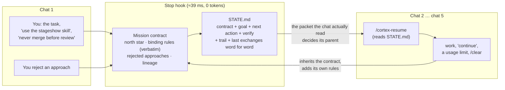
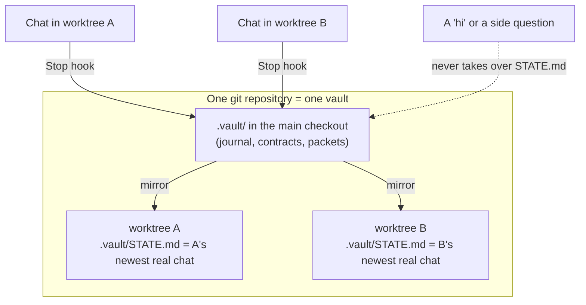
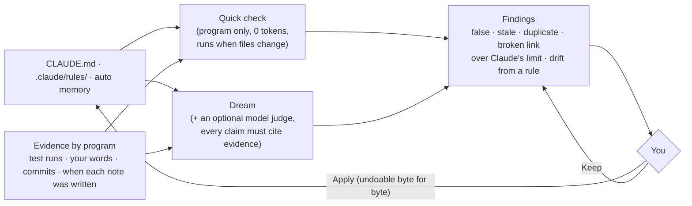
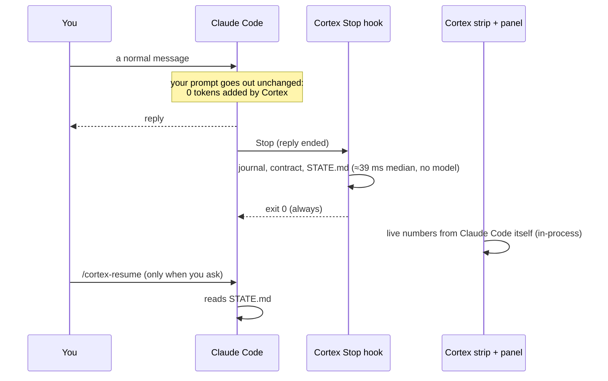

# How Kapex Cortex works

Kapex Cortex is a Claude Code plugin made of two parts: **shell hooks** that run when a reply ends and write files (no model, no tokens), and a **panel mod** that draws the status strip and the Cortex panel beside the chat. Nothing is added to your prompts. This page shows the three flows that matter.

## 1. The lossless handoff: a mission contract across any number of chats

Every reply ends with the Stop hook rewriting `.vault/STATE.md` from what Cortex already stored. Its top section, the **mission contract**, is carried from chat to chat as data, so chat 5 holds what you said in chat 1 word for word.

- **What carries over:** the north star (set once, never replaced by "continue" or "the limit reset"), your binding rules in your own words (skill mandates, never/must rules, decisions), the approaches you rejected and why, and the lineage (hop, origin chat, parent handoff, git head).
- **What doesn't:** reports and passing remarks ("I don't see the button", "No problem, carry on") never become rules or rejections. A rewound message and the harness's own notices ("You've hit your 5-hour limit") never become the goal.
- **When it ends:** say the task is done or start a new one ("New task: …"). The old contract is archived, so its rules can't send new work on a side quest.
- **Measured:** chat 5 keeps all 13 probes of the adversarial 5-hop telephone benchmark (`node scripts/benchmark.ts`); the v4.0.0 release's handoff kept 3 of the same 7 facts.

### Worktrees, parallel chats and /clear

Each chat writes its own packet first, outside any lock, so two chats ending a reply at the same moment never lose a turn. A `/clear` or a resume starts the strip's numbers over for the new chat at once.

## 2. Dream and Quick check: memory that matches the code

A rule the code has drifted from ("keep every file under 300 lines") is shown as drift: fix the code, or change the rule on purpose. It is never offered for deletion, whatever the evidence, and it counts as waiting for you until you decide. Nothing changes until you press Apply. Measured: 6/6 planted problems found, 0 false positives among 204 valid rules.

## 3. Zero passive injection

- **0 tokens injected into normal chats** by default. The handoff is pull-only: it reaches a chat only when you run `/cortex-resume` or press Resume. The old one-line "a handoff exists" note is opt-in (`kc prefs set startNotice on`).
- Cortex's skills (`/cortex-resume`, `/cortex-handoff`, `/cortex-init`, `/kc`) are things you start yourself, so they are marked `disable-model-invocation`: their descriptions stay out of Claude's context. Measured with `/context`: about 250 tokens per chat before v4.5, 0 after.
- **Stop hook:** about 39 ms median, 56.7 ms at p95 (bar 60) (whole process, Apple M4). It always exits 0 and logs errors to `.vault/private/errors.log`.
- **Panel refresh:** about 64 ms median (pre-built status file, git answers reused until git's own files change).

## Where things live

| Path | Holds | In git? |
|---|---|---|
| `.vault/STATE.md` | the handoff packet a new chat reads | no (ignored) |
| `.vault/private/` | journal, your messages (secrets scrubbed), per-chat packets and contracts | no (ignored) |
| `.vault/dreams/` | each Dream's before and after copies (for Undo) | no (ignored) |
| `.vault/cortex.json` | marks a project where Cortex is on | yes |
| `~/.cortex/` | your preferences | n/a |
